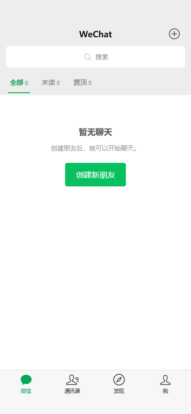
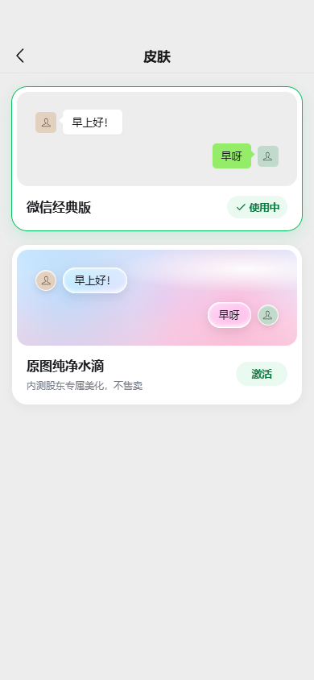

<div align="center">

# 屁屁机 · 小手机

自己部署的 AI 角色小手机，支持聊天、朋友圈、语音、日程与共同记忆。

网页版本 **v0.13.21** · 安卓 App **0.1.12**（安装编号 14） · Node.js 24+ · AGPL-3.0-only

[下载安卓 App](https://github.com/chouoi344/pipi-phone/releases/download/v0.13.20/pipi-phone-android-0.1.12-14.apk) · [快速开始](#快速开始) · [安装与升级](INSTALL.zh-CN.md) · [使用说明](docs/USAGE.zh-CN.md) · [更新记录](CHANGELOG.md) · [问题反馈](https://github.com/chouoi344/pipi-phone/issues)

</div>

一个独立账号，一部专属的小手机。你只需部署一台服务器，就能在安卓 App、iPhone 浏览器和电脑上看到同一份好友、聊天与共同记忆。聊天资料保存在你的服务器上，模型请求发送给你选择的服务商。

| 怎么使用 | 第一次怎么进 | 以后怎么更新 |
| --- | --- | --- |
| iPhone 或电脑浏览器 | 打开你的小手机网址，首次设置名字和密码 | 「我 → 设置 → 关于屁屁机 → 网页程序更新」 |
| 安卓 App | 先在网页设置密码，再在 App 粘贴同一个网址、输入密码，直接进入消息列表 | 「网页程序更新」更新服务器；「安卓 App 更新」只更新这台手机 |

安卓支持系统返回手势、切回聊天后恢复草稿，以及好友新消息通知。从安卓 0.1.3 起，服务器可以从 GitHub 取回官方安装包，再提供给手机。手机只需能访问自己的小手机网址。首次安装及自行构建步骤见[安卓使用说明](android/README.md)。

安卓 App 支持旧网页组件 WebView 83。搭配官方网页 v0.13.11 时，覆盖安装 App 即可使用原服务器。手机无法录音时仍可继续文字聊天和发图。

## 界面预览

<table>
  <tr>
    <th>经典版 · 首次进入</th>
    <th>皮肤选择</th>
  </tr>
  <tr>
    <td align="center"></td>
    <td align="center"></td>
  </tr>
</table>

截图来自空白安装。默认使用微信经典版，水滴版标注「内测股东专属美化，不售卖」，凭安装编号对应的激活码使用。

## 能做什么

| 功能 | 体验 |
| --- | --- |
| 好友与人设 | 创建独立好友，管理人设、角色资料、音色与参考照片 |
| 日常聊天 | 文字、图片、表情和语音，支持引用、撤回、收藏与聊天记录搜索 |
| 共同记忆 | 自动提炼长期记忆，支持查看、编辑、检索、归档、恢复与遗忘 |
| 角色生活 | 配置作息、日程与穿搭，使用照片、衣柜和主动联系功能 |
| 朋友圈 | 发布图文动态、管理可见范围，与好友点赞、评论和互动 |
| 虚拟互动 | 红包、转账、拍一拍与农场，虚拟钱包和现实账本各自独立 |
| 模型配置 | 配置服务商与不同用途的模型，设置主模型、回退顺序，查看用量与日志 |
| 数据管理 | TAR 备份、旧 JSON 恢复、媒体保存期限、账号与会话管理 |

语音合成、录音转写、生成图片和自动记忆等能力，需要配置对应模型。模型调用的可用性和费用取决于你选择的服务商。

## 快速开始

### Docker Compose

Ubuntu 云服务器首次安装需要 Git、curl、Python 3、Docker 和 Compose 2.24.4 或更新版本。放行公网 TCP 80、443 后，在管理员终端复制下面这行，安装最新正式版，同时启用 HTTPS 和网页一键更新。已经解压好源码的用户可以在项目目录直接运行 `python3 scripts/install-https.py`。

```sh
cd /opt && repo=https://github.com/chouoi344/pipi-phone && release=$(curl --http1.1 -fsSLI -o /dev/null -w '%{url_effective}' "$repo/releases/latest") && git -c http.version=HTTP/1.1 clone --depth 1 --branch "${release##*/}" "$repo.git" pipi-phone && cd pipi-phone && python3 scripts/install-https.py
```

安装完成后，终端会显示 `https://你的公网IP/`。在手机浏览器打开它，填写名字和至少 8 个字符的访问密码。安卓 App 也粘贴这个完整网址，使用同一个密码。浏览器首次录音时，点「允许使用麦克风」。服务器会自动申请并续期免费证书。

标准安装会准备网页更新服务所需的 Node.js，业务资料保存在 Docker 数据卷中。以后要升级服务器，请打开「我 → 设置 → 关于屁屁机 → 网页程序更新」。

只在自己电脑上试用时，在源码目录运行 `docker compose up -d --build`，打开 [http://127.0.0.1:18766/](http://127.0.0.1:18766/)。使用面板且已有 HTTPS 的服务器沿用原网址。[已有网站、端口冲突和安装说明](INSTALL.zh-CN.md#首次安装)

<details>
<summary>使用 Node.js 在本机直接运行</summary>

安装 Node.js 24 或更新版本后，在源码目录执行下面的命令。

```sh
npm ci --omit=dev
node server.cjs
```

Windows 也可以双击 `start.cmd`，Linux / macOS 可运行 `./start.sh`；启动脚本会在需要时安装锁定版本的图片处理依赖。打开 [http://127.0.0.1:18766/](http://127.0.0.1:18766/) 设置访问密码，默认资料目录为 `data/`。Docker 镜像已包含依赖。

</details>

### 接入模型，创建第一位好友

1. 在「我 → 设置 → 小手机 → 模型」添加服务商，填写接口地址和 API Key，获取模型列表或手动添加型号，再保存卡片。
2. 在「小手机 → 对话设置」选择对话主模型，使用对话模型旁的连接测试检查可用性。按需要为语音、图片和记忆等用途配置模型。
3. 从聊天首页「创建新朋友」添加好友，在「我 → 我的人设」维护与绑定人设。进入好友的「聊天信息 → 角色配置」调整音色、照片与日常设置。

首次安装的通讯录和聊天记录为空。默认关闭新好友的自动朋友圈，主动联系、日程与其他功能可以按需要开启。详细参数见[使用说明](docs/USAGE.zh-CN.md)。

## 更新与数据

当前网页版本为 **0.13.21**，安卓 App 沿用 **0.1.12**（安装编号 14），无需重新安装 App。打开「我 → 设置 → 关于屁屁机」，图标下方是服务器的网页版本。在安卓手机上点「安卓 App 更新」，可以查看这台手机的 App 版本。升级已有安装前，先导出备份，保留原部署目录、数据卷与环境变量。[0.13.0 数据升级说明](升级说明_0.13.0.md) · [更新记录](CHANGELOG.md)

- **备份与恢复**　在「我 → 设置 → 聊天记录管理」导出 TAR 备份，可恢复 TAR 和旧版 JSON。导出默认包含模型 API Key、图片和语音，可取消相应选项。含密钥的备份请妥善保管。
- **媒体保存**　聊天图片和语音默认保存 7 天，可在「存储空间」调整。服务器剩余空间不足时，会按时间清理最旧的聊天媒体。
- **资料保留**　恢复备份会替换目标安装的业务资料。普通升级继续使用原资料目录。`docker compose down -v` 会删除数据卷。
- **网页更新**　在「网页程序更新」检查新版，点「立即更新」。旧版公网 HTTPS 安装若显示「未启用一键更新」，可在原服务器执行一次启用命令。[旧版启用命令和网页更新说明](docs/WEB-UPDATE.zh-CN.md)
- **安卓更新**　新版服务器可提供 GitHub 正式发布的安卓安装包。打开「安卓 App 更新」，按手机的系统提示确认安装。这项功能可在网页一键更新服务关闭时使用。[安卓发布与更新说明](android/README.md#在-app-里更新)

## 常见问题

<details>
<summary>水滴皮肤怎么激活？</summary>

进入「我 → 皮肤」，点击水滴卡片右下角的「激活」，复制安装编号给皮肤提供者，再填写对应的专属激活码。验证在本地完成。同一套小手机的手机和电脑共用激活资格，各浏览器记住自己的皮肤选择。

保留原数据目录可延续激活。将业务备份导入另一套独立安装时，需使用与新安装编号相符的激活码。

</details>

<details>
<summary>哪些功能需要保持服务器运行？</summary>

聊天、定时提醒、日程和主动消息由服务器处理，需要保持服务器运行。浏览器打开时，其他好友来信可在页面顶部提醒。安卓 App 开启通知后可通过手机系统提醒来信，后台送达时间受系统省电设置影响。红包和转账用于虚拟互动。

</details>

<details>
<summary>遇到问题怎么排查？</summary>

Docker 部署先查看服务状态和日志。

```sh
docker compose ps
docker compose logs --tail 100 pipi-phone
```

模型调用失败时，检查服务商地址、API Key、型号和用途选择，再使用对应模型的连接测试。更多运行与升级问题见[安装说明](INSTALL.zh-CN.md)。

提交问题时，附上版本、部署方式、复现步骤和相关截图。分享日志与截图前，去除其中的密码和 API Key。[提交问题](https://github.com/chouoi344/pipi-phone/issues/new)

</details>

## 文档与验证

| 文档 | 内容 |
| --- | --- |
| [安装与升级](INSTALL.zh-CN.md) | 首次部署、HTTPS、反向代理、模型接入与密码重置 |
| [完整使用说明](docs/USAGE.zh-CN.md) | 角色、人设、语音、模型参数、记忆和各项功能细节 |
| [升级说明](升级说明_0.13.0.md) | 数据迁移、空间要求与回退方式 |
| [网页更新](docs/WEB-UPDATE.zh-CN.md) | 更新服务配置、版本检查与回退 |
| [0.13.0 审查报告](审查报告_v0.13.0.md) | 上一版本的检查范围、真机步骤与已知限制 |

开发检查可运行 `node --test tests/*.test.cjs`，也可用 `docker compose -f compose.test.yaml run --rm tests` 在隔离容器中执行。自动测试使用临时资料和本地模拟服务，真实模型与实体手机的验证范围以审查报告为准。

## 开源与致谢

整体按 **AGPL-3.0-only** 发布。WeUI、LiangNiang/fake-world、WeChatSwift 及其他引用的来源、版本、改动和许可保留在第三方说明中。[LICENSE](LICENSE) · [第三方说明](THIRD_PARTY_NOTICES.md)

部署者可通过 `SOURCE_URL` 配置当前运行版本的完整源码地址，「关于屁屁机 → 源代码」会打开该地址。配置方式见[安装说明](INSTALL.zh-CN.md#关于页源码入口)。
